<picture>
  <source media="(prefers-color-scheme: dark) and (max-width: 600px)" srcset="assets/header-dark-mobile.svg">
  <source media="(max-width: 600px)" srcset="assets/header-light-mobile.svg">
  <source media="(prefers-color-scheme: dark)" srcset="assets/header-dark.svg">
  
</picture>

关注 **AI 的成本与性能**，从模型能力到系统落地。

曾在 **宇宙厂** 与 **某明星初创** 实习，做过基础设施与 Agent 产品。

<picture>
  <source media="(prefers-color-scheme: dark) and (max-width: 600px)" srcset="assets/focus-dark-mobile.svg">
  <source media="(max-width: 600px)" srcset="assets/focus-light-mobile.svg">
  <source media="(prefers-color-scheme: dark)" srcset="assets/focus-dark.svg">
  
</picture>

<picture>
  <source media="(prefers-color-scheme: dark) and (max-width: 600px)" srcset="assets/tools-dark-mobile.svg">
  <source media="(max-width: 600px)" srcset="assets/tools-light-mobile.svg">
  <source media="(prefers-color-scheme: dark)" srcset="assets/tools-dark.svg">
  
</picture>

<picture>
  <source media="(prefers-color-scheme: dark) and (max-width: 600px)" srcset="assets/stats-dark-mobile.svg">
  <source media="(max-width: 600px)" srcset="assets/stats-light-mobile.svg">
  <source media="(prefers-color-scheme: dark)" srcset="assets/stats-dark.svg">
  
</picture>

<picture>
  <source media="(prefers-color-scheme: dark)" srcset="assets/snake-dark.svg">
  
</picture>

---

平时打乒乓球，也弹吉他。 曾组织乒乓球社团，喜欢把一群人聚到一起做事。

  <a href="https://momoyeyu.github.io/">Blog</a> ·
  <a href="https://www.xiaohongshu.com/user/profile/66c0ce98000000001d033f82">小红书</a> ·
  <a href="https://space.bilibili.com/171878754">Bilibili</a>

Code, then play.

