<picture>
  <source media="(prefers-color-scheme: dark)" srcset="assets/header-dark.svg">
  
</picture>

  <a href="https://momoyeyu.github.io/"><picture>
    <source media="(prefers-color-scheme: dark)" srcset="assets/badge-blog-dark.svg">
    
  </picture></a>&nbsp;
  <a href="https://www.xiaohongshu.com/user/profile/66c0ce98000000001d033f82"><picture>
    <source media="(prefers-color-scheme: dark)" srcset="assets/badge-red-dark.svg">
    
  </picture></a>&nbsp;
  <a href="https://space.bilibili.com/171878754"><picture>
    <source media="(prefers-color-scheme: dark)" srcset="assets/badge-bilibili-dark.svg">
    
  </picture></a>

关注 <strong>AI 的成本与性能</strong>，从模型能力到系统落地。

曾在 <strong>宇宙厂</strong> 与 <strong>某明星初创</strong> 实习，做过基础设施与 Agent 产品。

<picture>
  <source media="(prefers-color-scheme: dark)" srcset="assets/workspace-dark.svg">
  
</picture>

<picture>
  <source media="(prefers-color-scheme: dark)" srcset="assets/github-dark.svg">
  
</picture>

